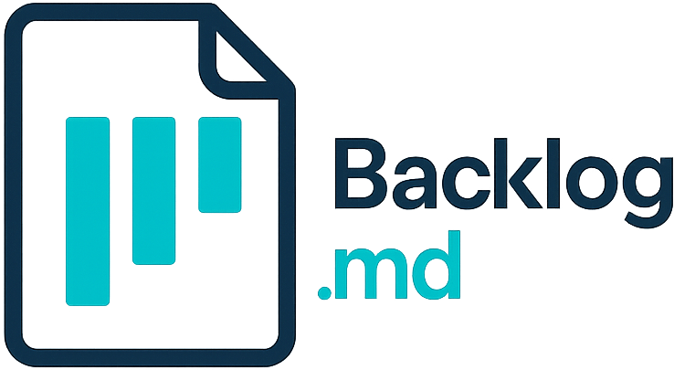
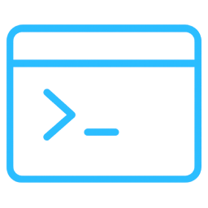

<p align="center">
  
</p>

<h1 align="center">AgenticWorkspace</h1>
<p align="center"><strong>Markdown‑native Task Manager &amp; Kanban visualizer for any Git repository</strong></p>
<p align="center">AI agents write the code. You review the tasks: before, during, and after.</p>

<p align="center">
  <a href="https://www.npmjs.com/package/agenticworkspace"></a>
  <a href="https://www.npmjs.com/package/agenticworkspace"></a>
  <a href="https://github.com/BarrMan/agentic-workspace/blob/main/LICENSE"></a>
  <a href="https://github.com/BarrMan/agentic-workspace"></a>
</p>

<p align="center">
<code>npm i -g agenticworkspace</code>
</p>


---

> **AgenticWorkspace** turns any folder into a **self‑contained project board**
> powered by plain Markdown files and a zero‑config CLI.

## Why AgenticWorkspace in the AI era

AI agents can now produce more plausible code in an hour than you can carefully read in a day.
The bottleneck is no longer writing code. It's your attention. You can't meaningfully review
15,000 generated lines in one sitting, but you can read a screenful of task descriptions
before any code exists, and push back while a misunderstanding is still one sentence,
not a rebuilt feature.

AgenticWorkspace structures agent work around **three review checkpoints**:

1. **Review the spec:** the agent decomposes your idea into tasks with descriptions and
   milestones before implementation starts.
2. **Review durable task artifacts:** the agent can record requirements and plans as task
   artifacts. Approval is attached to the exact content reviewed.
3. **Review the code:** one task = one context window = one PR. Diffs stay a size a human can
   actually read.

Afterwards, the completed tasks remain in Git as a permanent record of what was attempted and why,
legible to you, your team, and the next agent.

**Dogfooded:** nearly all of AgenticWorkspace's own code is written by AI agents working through
AgenticWorkspace itself. The full task ledger lives in this repo's [backlog folder](backlog/tasks).

📺 **See it in action:** [Devoxx Belgium 2025](https://www.youtube.com/watch?v=LSoDQU_9MMA) · [AI Engineer Code Summit 2025](https://www.youtube.com/watch?v=zMXKhhwiCIc)

## Features

* 🤖 **AI-ready** -- works with Claude Code, Gemini CLI, Codex, Kiro & any other MCP or CLI compatible AI assistant

* 📝 **Markdown-native tasks** -- every task is a plain `.md` file in your repo

* ✅ **Task artifacts** -- keep durable requirements, plans, and other working documents alongside each task

* 🎯 **Milestones & dependencies** -- structure bigger efforts and make execution order reviewable, with task detail showing what a task waits on and what waits on it

* 📊 **Terminal Kanban** -- `agenticworkspace board` paints a live board in your shell; `agenticworkspace board export` creates shareable markdown reports

* 🔍 **Search** -- fuzzy search across tasks, docs & decisions with `agenticworkspace search`

* 🔒 **Local-first** -- no server, no account, no telemetry; tasks are plain files in your repo, and remote Git operations are optional

* 💻 Cross-platform (macOS, Linux, Windows) · 🆓 MIT-licensed & open-source


---

##  Getting started

```bash
# Install
npm i -g agenticworkspace
# or: bun add -g agenticworkspace
# or: brew install agenticworkspace
# or: nix run github:BarrMan/agentic-workspace

# Initialize in any Git repo
agenticworkspace init "My Awesome Project"

# Or initialize without Git for local/non-code projects
agenticworkspace init "Personal Planning" --no-git
```

> [!TIP]
> **Running one-off with `npx`?** This tool's npm package is named `agenticworkspace`, so use the full name: `npx agenticworkspace init "My Project"`, `npx agenticworkspace board`.
> With `agenticworkspace` installed as a project dependency, `npx agenticworkspace` runs the local binary as usual.

### Run with Nix

Run AgenticWorkspace directly from the repository flake:

```bash
nix run github:BarrMan/agentic-workspace -- --version
```

Or install the named package into your Nix profile:

```bash
nix profile install github:BarrMan/agentic-workspace#agenticworkspace
```

The Nix flake supports `x86_64-linux`, `aarch64-linux`, and
`aarch64-darwin`. The x86_64 Linux package uses Bun's baseline runtime so it
also works on pre-AVX2 processors with AVX support. Intel macOS users can use
the npm, Bun, or Homebrew installation instead.

The init wizard will ask how you want to connect AI tools:
- **CLI instructions** (recommended): creates a short instruction file that tells agents to run `agenticworkspace instructions overview`.
- **MCP connector**: optionally auto-configures Claude Code, Codex, Gemini CLI, Kiro or Cursor for teams that prefer MCP.
- **Skip**: no AI setup; use AgenticWorkspace purely as a task manager.

For Cursor with CLI instructions, select AGENTS.md or pass `--agent-instructions cursor`; both use the same AGENTS.md target. AgenticWorkspace preserves existing AGENTS.md content and does not migrate or remove unrelated user-managed `.cursor/rules` files.

Everything is stored as human-readable Markdown in a project-local backlog folder such as `backlog/`, `.backlog/`, or a custom project-relative path configured through `backlog.config.yml` (e.g. `backlog_directory: my-backlog`). Task IDs use a configurable prefix (`agenticworkspace init --task-prefix`): the default produces `TASK-1`-style IDs, while this repository uses `back`, so examples below show `BACK-1`-style IDs. Git is optional: `agenticworkspace init --no-git` creates a filesystem-only project.

### Structured record format

Every application-owned structured field is stored in versioned YAML frontmatter. Tasks and drafts use `task_schema_version: 3`, decisions use `decision_schema_version: 1`, and milestones use `milestone_schema_version: 1`. The Markdown body is opaque free-form content. Task-specific durable documents are artifacts in the task container, separate from the task record.

```yaml
---
task_schema_version: 2
id: BACK-1
title: Add project search
status: To Do
description: |
  Search tasks, documents, and decisions from one command.
---

# Working notes

- This heading and checkbox are body content, not task fields.
```

---

## Working with AI agents

This is the recommended flow for Claude Code, Codex, Gemini CLI, Kiro and similar tools, following the **spec‑driven AI development** approach.
After running `agenticworkspace init`, agents should start by running `agenticworkspace instructions overview`. Work in this loop:

**Step 1: Describe your idea.** Tell the agent what you want to build and ask it to split the work into small tasks with clear descriptions.

**🤖 Ask your AI Agent:**
> I want to add a search feature to the web view that searches tasks, docs, and decisions. Please decompose this into small AgenticWorkspace tasks.

> [!NOTE]
> **Review checkpoint #1:** read the task descriptions.

**Step 2: One task at a time.** Work on a single task per agent session, one PR per task. Good task splitting means each session can work independently without conflicts. Make sure each task is small enough to complete in a single conversation. You want to avoid running out of context window.

**Step 3: Choose a mode.** Use **PLAN** to discuss requirements and capture useful `spec.md` and `plan.md` artifacts; use **BUILD** to implement and verify. These are workflow presets, not sandbox boundaries. Permissions are sent to the agent harness where supported and are otherwise conveyed as instructions; they do not guarantee enforcement. Each mode uses the project's default model unless you set one explicitly with `agenticworkspace agent-config model set <modelId> --mode <mode>`.

**🤖 Ask your AI Agent:**
> Work on BACK-10 in PLAN mode. Help clarify requirements and write a spec artifact if useful. Do not begin implementation unless I ask to switch to BUILD.

> [!NOTE]
> **Review checkpoint #2:** review useful task artifacts before implementation. Artifact approval applies to the exact bytes reviewed; subsequent edits require a new approval.

**Step 4: Implement and verify.** Let the agent implement the task.

> [!NOTE]
> **Review checkpoint #3:** review the code, run tests, check linting, and verify the results match your expectations.

Mark verified work Done (or the configured final status). During periodic cleanup, use `agenticworkspace task complete` to move it off the board while preserving its record and dependency links. Use `agenticworkspace task archive` for canceled, duplicate, or invalid work; it removes incoming dependencies and task references.

Task artifacts are generic files for durable task context. List, inspect, write, and check approval state with `agenticworkspace task artifact` commands. The `.artifacts.json` sidecar stores user approval hashes and timestamps; agents cannot write or approve that sidecar. The sidecar is not a sandbox or a workflow gate.

Flat task and draft records are unsupported. Manually move each `<name>.md` from `backlog/tasks/` or `backlog/drafts/` to `<lowercase-id>/task.md` under the same root; set frontmatter `id` to exactly match the directory name and `task_schema_version` to `3`. Preserve any legacy summary content manually before editing the record. Version-1 agent session state is also unsupported; back it up, set `version` to `2`, move `sessions` and `activeSessionId` into `modes.build`, and preserve `taskId` before using workspace sessions.

`agenticworkspace workspace` and interactive board entry require a valid mode catalog in the project's own configuration. Missing project configuration or missing `modes` produces an actionable error before terminal setup; root/card settings and built-in defaults do not supply a fallback catalog. `agenticworkspace agent-config init project` initializes only the missing project catalog. See [the mode startup contract](docs/modes-phase1-contract.md#workspace-startup).

---

## Working without AI agents

Use AgenticWorkspace as a standalone task manager from the terminal.

```bash
# Create and refine tasks
agenticworkspace task create "Render markdown as kanban"
agenticworkspace task artifact list BACK-1
agenticworkspace task artifact write BACK-1 notes.md --from notes.md
agenticworkspace task artifact status BACK-1 notes.md

# Track work
agenticworkspace task list -s "To Do"
agenticworkspace task list --json | jq '.tasks[] | .id'
agenticworkspace search "kanban"
agenticworkspace board
```

You can switch between AI-assisted and manual workflows at any time; both operate on the same Markdown task files. Just prefer AgenticWorkspace commands (CLI/MCP) over hand-editing task files, so field types and metadata stay consistent.

Read commands support stable, versioned JSON for scripts and integrations. Use `--json` with `task list`, `task view`, the `task <id>` shorthand, and `search`. JSON mode is noninteractive and keeps successful stdout machine-readable. Add `--watch` to `task list --json` for an initial full list followed by changed full replacements, using the exact same JSON format. Read successive complete JSON values; each response replaces the previous list.

**Learn more:** [CLI reference](CLI-INSTRUCTIONS.md) | [Advanced configuration](ADVANCED-CONFIG.md)

---

## 🔧 MCP Integration (Model Context Protocol)

CLI instructions are the default AI setup. MCP remains supported for AI coding assistants like Claude Code, Codex, Gemini CLI and Kiro when you explicitly prefer an MCP connector.
You can run `agenticworkspace init` (even if you already initialized AgenticWorkspace) and choose MCP integration, or follow the manual steps below.

### Client guides

<details>
  <summary><strong>Claude Code</strong></summary>

  ```bash
  claude mcp add agenticworkspace --scope user -- agenticworkspace mcp start
  ```

</details>

<details>
  <summary><strong>Codex</strong></summary>

  ```bash
  codex mcp add agenticworkspace -- agenticworkspace mcp start
  ```

</details>

<details>
  <summary><strong>Gemini CLI</strong></summary>

  ```bash
  gemini mcp add agenticworkspace -s user agenticworkspace mcp start
  ```

</details>

<details>
  <summary><strong>Kiro</strong></summary>

  ```bash
  kiro-cli mcp add --scope global --name agenticworkspace --command agenticworkspace --args mcp,start
  ```

</details>

<details>
  <summary><strong>Cursor / other MCP clients</strong></summary>

  Use the manual JSON config below in your client's MCP settings.

</details>

Use the shared `agenticworkspace` server name everywhere. The server finds the active project from your client's MCP roots, and re-resolves when you switch workspace or worktree. A single user-scope server covers every repo.

<details>
  <summary><strong>Manual config</strong></summary>

```json
{
  "mcpServers": {
    "agenticworkspace": {
      "command": "agenticworkspace",
      "args": ["mcp", "start"],
      "env": {
        "BACKLOG_CWD": "/absolute/path/to/your/project"
      }
    }
  }
}
```

Set `BACKLOG_CWD` to pin the server to one project and stop workspace following. Use it to always target the same backlog, or when your client can't report MCP roots.
If your IDE supports custom args but not env vars, you can also use `["mcp", "start", "--cwd", "/absolute/path/to/your/project"]`.
Until the server finds an initialized project, it serves `backlog://init-required`.

</details>

> [!IMPORTANT]
> When adding the MCP server manually, add a short instruction to your CLAUDE.md/AGENTS.md files telling agents to read `backlog://workflow/overview`.
> This step is not required when using `agenticworkspace init` as it adds these instructions automatically.
> For CLI-based setups, use `agenticworkspace instructions overview` to fetch the current workflow guidance.


Once connected, agents can read the AgenticWorkspace workflow instructions via `backlog://workflow/overview`, with detailed guides at `backlog://workflow/task-creation`, `backlog://workflow/task-execution`, and `backlog://workflow/task-finalization`.
Use `/mcp` command in your AI tool (Claude Code, Codex, Kiro) to verify if the connection is working.

---

##  CLI reference

Full command reference covering task management, search, board, docs, decisions, and more: **[CLI-INSTRUCTIONS.md](CLI-INSTRUCTIONS.md)**

Quick examples: `agenticworkspace`, `agenticworkspace instructions`, `agenticworkspace task create`, `agenticworkspace task list`, `agenticworkspace task edit`, `agenticworkspace milestone add`, `agenticworkspace milestone rename`, `agenticworkspace milestone remove`, `agenticworkspace search`, `agenticworkspace board`.

Full help: `agenticworkspace --help`

---

##  Configuration

AgenticWorkspace works with zero configuration. Settings merge from CLI flags, then the project config file (`backlog.config.yml` when present, otherwise `backlog/config.yml` or `.backlog/config.yml`), then built‑in defaults.

Run `agenticworkspace config` with no arguments to launch the interactive wizard (the same experience triggered from `agenticworkspace init` advanced setup). It walks through cross-branch accuracy (`checkActiveBranches`, `remoteOperations`, `activeBranchDays`), Git workflow (`bypassGitHooks`), ID formatting (`zeroPaddedIds`), and editor integration (`defaultEditor`). Skipping the wizard applies the safe built-in defaults, and rerunning `agenticworkspace init` or `agenticworkspace config` pre-populates prompts with your current values.

For filesystem-only projects (`agenticworkspace init --no-git`), the saved config forces `checkActiveBranches=false` and `remoteOperations=false` so CLI and MCP local-file workflows do not depend on a Git repository.

For the full configuration reference (all options, default values, commands, and detailed notes), see **[ADVANCED-CONFIG.md](ADVANCED-CONFIG.md)**.

---

## Troubleshooting

### Apple Silicon (macOS)

On M-series Macs, `agenticworkspace` can fail with `illegal hardware instruction` or `Binary package not installed for darwin-...` when Node, Bun, or Homebrew run under Rosetta (x64 emulation) and install the Intel binary instead of the arm64 one — or the other way around. The launcher runs whichever darwin variant (arm64 or x64) is actually installed, but a clean native-arch install is the reliable fix.

Check what your tools report:

```bash
uname -m                            # arm64 = Apple Silicon hardware; x86_64 = Intel or a Rosetta shell
node -p process.arch                # architecture of your Node/Bun runtime
sysctl -in sysctl.proc_translated   # 1 = current shell runs under Rosetta
which brew                          # /opt/homebrew = arm64 brew, /usr/local = Intel brew
```

If the architectures disagree, reinstall with the native one:

```bash
# Homebrew: make sure `which brew` prints /opt/homebrew, then
  brew reinstall agenticworkspace

# npm
arch -arm64 npm i -g agenticworkspace

# Bun
arch -arm64 bun add -g agenticworkspace
```

Running an x64 Node under Rosetta on purpose also works: `agenticworkspace` falls back to whichever `agenticworkspace-darwin-*` package is present.

---

## 📺 Talks & Community

Watch AgenticWorkspace in action:

- **Devoxx Belgium 2025**: [the spec-driven agent workflow behind AgenticWorkspace, live on stage](https://www.youtube.com/watch?v=LSoDQU_9MMA)
- **AI Engineer Code Summit 2025**: [AgenticWorkspace: task management for AI agents](https://www.youtube.com/watch?v=zMXKhhwiCIc)
- Slides from these and more talks: [mrlesk.com/talks](https://mrlesk.com/talks)

### Community tools

- **[vscode-backlog-md](https://marketplace.visualstudio.com/items?itemName=ysamlan.vscode-backlog-md)** - VS Code extension with issues panel, kanban view, and editing. ([ysamlan/vscode-backlog-md](https://github.com/ysamlan/vscode-backlog-md))

---

## License

AgenticWorkspace is released under the **MIT License**: do anything, just give credit. See [LICENSE](LICENSE).
